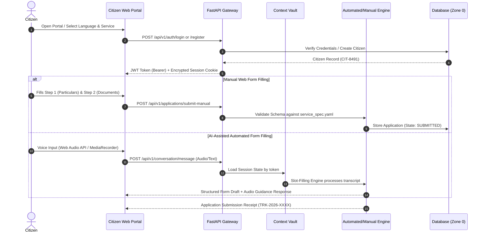
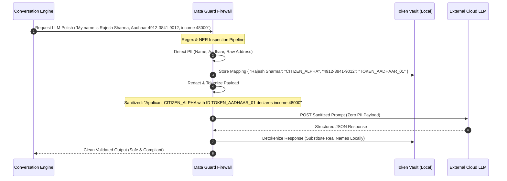
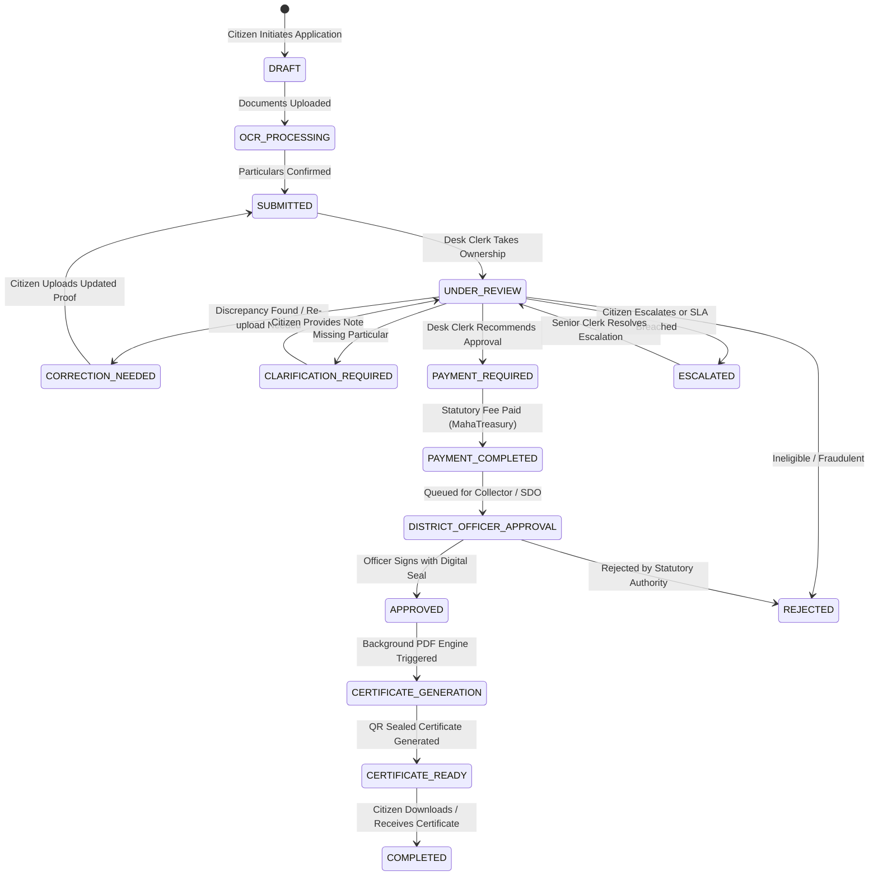
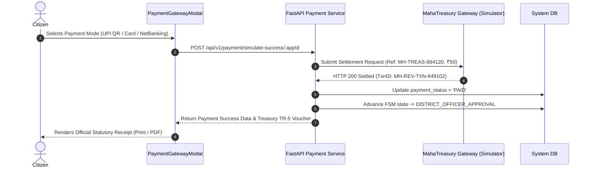

# RevGOV Platform — Comprehensive Data Flow Architecture Specification

**Document Identifier:** `REV-DOC-ARCH-DATAFLOW-2026-V3`  
**System Name:** RevGOV Revenue Services & Statutory Certificate Delivery Platform  
**Target Architecture:** Enterprise On-Premise / Hybrid Data-Sovereign Government Deployment  
**Standard Compliance:** Information Technology Act 2000, Digital Personal Data Protection Act (DPDPA), Maharashtra Right to Public Services Act  
**Language Scope:** 10 Indian Regional Languages (English, Hindi, Marathi, Bengali, Telugu, Tamil, Gujarati, Kannada, Malayalam, Punjabi)

---

## Table of Contents

1. [Executive Summary & Core Architectural Principles](#1-executive-summary--core-architectural-principles)
2. [End-to-End Macro Data Flow Topology](#2-end-to-end-macro-data-flow-topology)
3. [Channel Ingestion & Omnichannel Continuity Flow](#3-channel-ingestion--omnichannel-continuity-flow)
   - 3.1 Web Portal Data Flow (Manual & AI-Assisted Automated)
   - 3.2 WhatsApp Webhook & Media Pipeline Flow
   - 3.3 IVR Telephony & Voice Audio Streaming Flow
   - 3.4 Context Vault & Cross-Channel Handoff Flow
4. [Data Guard Trust Boundary & Zero-Trust PII Redaction Flow](#4-data-guard-trust-boundary--zero-trust-pii-redaction-flow)
   - 4.1 Data Classification Matrix (Restricted / Quasi-Identifier / Non-Sensitive)
   - 4.2 Inbound Sanitization & Cloud Interception Sequence
   - 4.3 Field-Level AES-256-GCM Encryption Architecture
5. [Document Intelligence, OCR, Isolation & Discrepancy Flow](#5-document-intelligence-ocr-isolation--discrepancy-flow)
   - 5.1 Ingestion, Validation & Secure Storage Flow
   - 5.2 Tesseract OCR & PyMuPDF Extraction Pipeline
   - 5.3 Isolation, Confidence Scoring & Transliteration Matching
   - 5.4 Side-by-Side Mismatch Resolution Flow
6. [Application Lifecycle & 14-Stage Deterministic FSM Flow](#6-application-lifecycle--14-stage-deterministic-fsm-flow)
   - 6.1 Complete Finite State Machine Flow Diagram
   - 6.2 Pre-Payment Verification Guarantee Invariant
   - 6.3 State Transition Data Payloads
7. [Government Workstation Scrutiny & Approval Data Flow](#7-government-workstation-scrutiny--approval-data-flow)
   - 7.1 Desk Clerk First-Mile Review Flow
   - 7.2 District Officer Final Administrative Review & Digital Signing
   - 7.3 Escalation, SLA Timers & Grievance Triage Flow
8. [Statutory Fee Payment & MahaTreasury Gateway Flow](#8-statutory-fee-payment--mahatreasury-gateway-flow)
   - 8.1 Fee Calculation & Demand Note Generation
   - 8.2 MahaTreasury e-Pay Payment Execution (UPI / Card / Net Banking)
   - 8.3 Idempotent Webhook Callback & Treasury Form TR-5 Receipt Flow
9. [Certificate Generation, Cryptographic Sealing & Public Verification Flow](#9-certificate-generation-cryptographic-sealing--public-verification-flow)
   - 9.1 ReportLab PDF Generation & Digital Watermarking
   - 9.2 2D Cryptographic QR Code Encoding
   - 9.3 Zero-Auth Public Verification Portal Data Flow
10. [10-Language Regional Localization Data Flow](#10-10-language-regional-localization-data-flow)
    - 10.1 Key Resolution & Catalog Topology
    - 10.2 Dynamic Service, Slot & Status Translation Pipeline
    - 10.3 Internationalization Formatting Flow
11. [Audit Logging, Server-Sent Events (SSE) & Observability Flow](#11-audit-logging-server-sent-events-sse--observability-flow)
    - 11.1 Dual-Stream Event & Compliance Trail
    - 11.2 Realtime SSE Broadcast Bus
    - 11.3 Audit Log Export & Traceability Matrix

---

## 1. Executive Summary & Core Architectural Principles

The **RevGOV Platform** is an enterprise-grade, omnichannel, voice-first digital governance system for municipal and state revenue departments. It automates statutory certificate delivery (Income, Caste, Domicile, Non-Creamy Layer, EWS, Birth, Death, etc.) while removing technical, linguistic, and literacy barriers.

### Core Data Flow Principles

```
┌────────────────────────────────────────────────────────────────────────────────────────┐
│                              DATA FLOW CORE PRINCIPLES                                 │
├────────────────────────────────────────────────────────────────────────────────────────┤
│ 1. ZERO-TRUST PII BOUNDARY        │ No raw citizen PII crosses the on-premise firewall.│
│ 2. CHANNEL-AGNOSTIC CONTEXT VAULT │ State lives in database, never in the channel wire.│
│ 3. PRE-PAYMENT OFFICER APPROVAL   │ Statutory fees are collected ONLY after review.    │
│ 4. DETERMINISTIC 14-STAGE FSM     │ State transitions are idempotent & strictly logged.│
│ 5. CRYPTOGRAPHIC VERIFIABILITY    │ Issued certificates are publicly verifiable via QR.│
│ 6. DUAL-STREAM AUDIT TRAIL        │ Every read, write, transition, and export is logged.│
└────────────────────────────────────────────────────────────────────────────────────────┘
```

---

## 2. End-to-End Macro Data Flow Topology

The macro architecture consists of seven structured layers operating across **three strict security trust boundaries**:

```
                       CITIZEN TOUCHPOINTS (UNTRUSTED ZONE 2)
  ┌──────────────────┬─────────────────┬──────────────────┬──────────────────┐
  │  Web Portal UI   │  WhatsApp Web   │  IVR Phone Call  │  Assisted Kiosk  │
  └────────┬─────────┴────────┬────────┴────────┬─────────┴────────┬─────────┘
           │                  │                 │                  │
           ▼                  ▼                 ▼                  ▼
┌────────────────────────────────────────────────────────────────────────────┐
│                    API GATEWAY & SECURITY PERIMETER                        │
│   • Rate Limiting (Sliding Window)   • Magic MIME Type Verification        │
│   • Max Body Size Guard (10MB)       • TLS 1.3 Termination & CSP Guard     │
└─────────────────────────────────────┬──────────────────────────────────────┘
                                      │
                                      ▼
┌────────────────────────────────────────────────────────────────────────────┐
│                  CONTEXT VAULT & SESSION RESOLUTION                        │
│   • Channel Identity Mapping (`CIT-xxxx`) • Cross-Channel State Migration  │
│   • Session Token Authentication           • Redis/Memory Session Cache    │
└─────────────────────────────────────┬──────────────────────────────────────┘
                                      │
                                      ▼
┌────────────────────────────────────────────────────────────────────────────┐
│                 DATA GUARD SECURITY FIREWALL (ZONE 0 / 1)                  │
│   • PII Classification Engine (Regex + OPA) • Quasi-Identifier Redaction   │
│   • Cloud LLM Interception Proxy            • Reversible Token Hashing     │
└─────────────────────────────────────┬──────────────────────────────────────┘
                                      │
                                      ▼
┌────────────────────────────────────────────────────────────────────────────┐
│                     CORE ORCHESTRATION & SERVICES                          │
│   • 14-Stage Application State Machine     • Deterministic Slot Filling    │
│   • Dual OCR Engine (Tesseract + PyMuPDF)  • 5-Pillar Readiness Scorer     │
│   • Explainable Fraud Risk Engine          • Service Spec YAML Rules       │
└──────────────────┬─────────────────────────────────────┬───────────────────┘
                   │                                     │
                   ▼                                     ▼
┌───────────────────────────────────────┐ ┌──────────────────────────────────┐
│   GOVERNMENT WORKSTATION PORTALS      │ │  STATUTORY OUTCOME ENGINES       │
│   • Desk Clerk Review (Scrutiny)      │ │  • MahaTreasury e-Pay Gateway    │
│   • District Officer / Tahsildar Seal │ │  • ReportLab PDF & QR Generator  │
│   • Compliance Audit & SLA Escalations│ │  • Public Verification Endpoint  │
└──────────────────┬────────────────────┘ └──────────────────┬───────────────┘
                   │                                         │
                   └──────────────────┬──────────────────────┘
                                      │
                                      ▼
┌────────────────────────────────────────────────────────────────────────────┐
│                 PERSISTENCE & OBSERVABILITY (ZONE 0 CORE)                  │
│   • SQLite / PostgreSQL WAL Storage        • Field-Level AES-256-GCM       │
│   • Real-Time SSE EventBus (Broadcast)     • Dual-Stream Audit Trail Store │
└────────────────────────────────────────────────────────────────────────────┘
```

---

## 3. Channel Ingestion & Omnichannel Continuity Flow

RevGOV provides seamless omnichannel access where a citizen can initiate an application on one channel and finish on another without loss of state.

### 3.1 Web Portal Data Flow



### 3.2 WhatsApp Webhook & Media Pipeline Flow

1. **Inbound Webhook Receipt**:
   - Webhook endpoint: `POST /api/v1/webhook/whatsapp`.
   - Validates HMAC-SHA256 signature against departmental application secret.
   - Extracts sender telephone number (MSISDN: `+919876543210`), message text, or voice media URL.
2. **Citizen Resolution**:
   - `CitizenResolver` hashes the phone number with departmental salt to resolve `citizen_ref` (`CIT-WHATSAPP-XXXX`).
   - Retrieves active application draft from the Context Vault.
3. **Voice Note Processing**:
   - Inbound OGG/Opus audio is downloaded to memory buffer.
   - Converted to 16kHz WAV format in an on-premise container.
   - Transcribed via local Whisper ASR engine into target regional text.
4. **Outbound Response Dispatch**:
   - Dialog Engine generates interactive WhatsApp interactive buttons or WhatsApp media template.
   - Dispatched via WhatsApp Business API gateway asynchronously.

### 3.3 IVR Telephony & Voice Audio Streaming Flow

1. **Incoming Call Arrival**:
   - Citizen dials toll-free departmental number (`1800-120-8040`).
   - Inbound telephony webhook hits `POST /api/v1/ivr/incoming`.
2. **Interactive Audio Exchange**:
   - Generates TwiML / Asterisk XML greeting prompt in citizen's selected language.
   - Gathers DTMF touch-tones (Service selection: 1 = Income, 2 = Domicile, 3 = Status Check).
   - Citizen speaks application ID or particulars; audio is captured via `<Record>` stream.
3. **DTMF & Voice State Transitions**:
   - Transcribed speech is routed to `NextQuestionEngine`.
   - Application status queries return dynamic synthesized TTS audio reading out the exact tracking milestone.

### 3.4 Context Vault & Cross-Channel Handoff Flow

```
┌─────────────────────────────────────────────────────────────────────────────┐
│                    CONTEXT VAULT SESSION CONTINUITY FLOW                    │
├─────────────────────────────────────────────────────────────────────────────┤
│ 1. Citizen starts on WhatsApp:                                              │
│    • Name: "Rajesh Sharma", District: "Pune", Service: "Income Certificate" │
│    • State saved to DB: session_token = "SESS-7891", draft_id = "APP-4011" │
│                                                                             │
│ 2. Citizen opens Web Portal on Desktop:                                     │
│    • Clicks "Resume Application" -> Enters Phone or Tracking ID             │
│    • OTP verified via SMS/WhatsApp -> Context Vault loads SESS-7891         │
│                                                                             │
│ 3. Instant Continuity:                                                      │
│    • All 12 previously collected fields appear pre-filled in Web Form       │
│    • Citizen uploads high-res PDF proofs on Web                             │
│    • Application transitions from DRAFT -> SUBMITTED seamlessly             │
└─────────────────────────────────────────────────────────────────────────────┘
```

---

## 4. Data Guard Trust Boundary & Zero-Trust PII Redaction Flow

The RevGOV Data Guard enforces a runtime firewall between on-premise sensitive records and external cloud AI models.

### 4.1 Data Classification Matrix

| Classification Level | Attributes | Permitted Destination | Storage Encryption |
|---|---|---|---|
| **RESTRICTED** | Aadhaar Number, Full Name, Phone, Email, Bank Account, Street Address, Biometric Signature | On-Premise Zone 0 Core Only (Never Cloud) | AES-256-GCM at rest |
| **QUASI-IDENTIFIER** | Date of Birth, District, Pin Code, Caste Sub-Category, Annual Income Bracket | Zone 1 Sanitized Proxy (K-anonymized) | Hashed / Salted |
| **NON-SENSITIVE** | Service ID, Application Status, Timestamp, Language Code, SLA Milestone | Zone 2 Cloud AI Allowed | Standard TLS 1.3 |

### 4.2 Inbound Sanitization & Cloud Interception Sequence



### 4.3 Field-Level AES-256-GCM Encryption Architecture

1. **Key Derivation**: Departmental Master Key (`REVENUE_MASTER_KEY`) derives unique initialization vectors (IV) per application record using HKDF (HMAC-based Extract-and-Expand Key Derivation Function).
2. **Authenticated Encryption**: Encrypted fields append a 16-byte authentication tag ensuring both confidentiality and tamper detection.
3. **Database Security**: Direct database inspection reveals ciphertext only (`enc::v1::gcm::...`).

---

## 5. Document Intelligence, OCR, Isolation & Discrepancy Flow

```
┌─────────────────┐     ┌─────────────────────┐     ┌──────────────────────┐
│ Citizen Uploads │     │ Magic Byte Security │     │ PyMuPDF & Tesseract  │
│ JPEG / PNG / PDF│────>│ & Antivirus Scanner │────>│ Dual OCR Extraction  │
└─────────────────┘     └─────────────────────┘     └──────────┬───────────┘
                                                               │
                                                               ▼
┌─────────────────┐     ┌─────────────────────┐     ┌──────────────────────┐
│  Side-by-Side   │     │ Fuzzy Transliterate │     │ Structured Entities: │
│ Resolution Modal│<────│ Discrepancy Check   │<────│ Name, Age, Address,  │
│ (Citizen Choice)│     │ (< 85% Confidence)  │     │ Income, Certificate #│
└─────────────────┘     └─────────────────────┘     └──────────────────────┘
```

### 5.1 Ingestion, Validation & Secure Storage Flow
- Binary payload inspected using `python-magic` to confirm true MIME headers (blocks disguised `.exe` / scripts).
- Saved into an isolated, non-executable filesystem directory (`/storage/documents/isolated/{app_id}/`).
- Read-access requires authenticated backend streaming token.

### 5.2 Tesseract OCR & PyMuPDF Extraction Pipeline
- Multi-page PDFs split into high-DPI 300 DPI raster images via PyMuPDF.
- Grayscale contrast equalization and adaptive thresholding applied to enhance faint government rubber stamps.
- Tesseract executes with Indic script training data (`hin`, `mar`, `tam`, `tel`, `mal`, `eng`).

### 5.3 Isolation, Confidence Scoring & Transliteration Matching
- Extracted key-value pairs assigned a Bayesian Confidence Score (0.00 – 1.00).
- Levenshtein Distance and Soundex/Metaphone phonetic algorithms cross-verify declared name vs document text.

### 5.4 Side-by-Side Mismatch Resolution Flow
If a discrepancy is identified (e.g. Form: *Rajesh Kumar Sharma* vs Aadhaar OCR: *Rajesh K. Sharma*):
1. The platform generates an Interactive Discrepancy Resolution Object.
2. The citizen is presented with the mismatch side-by-side:
   - **Option A (Declared Value)**: Retain manual form input.
   - **Option B (OCR Extracted Value)**: Auto-correct using scanned identity proof.
3. Citizen selection is cryptographically recorded with timestamp and consent flag.

---

## 6. Application Lifecycle & 14-Stage Deterministic FSM Flow

### 6.1 Complete Finite State Machine Flow Diagram



### 6.2 Pre-Payment Verification Guarantee Invariant
> **CRITICAL LEGAL INVARIANT:**  
> In traditional portals, citizens pay fees upfront only to face rejection without refund. In RevGOV, state `PAYMENT_REQUIRED` is **strictly unreachable** until a Desk Clerk completes documentary scrutiny.

### 6.3 State Transition Data Payloads

Every state transition generates an immutable transition event:
```json
{
  "event_id": "EVT-STATE-90142",
  "application_id": "APP-2026-9481",
  "tracking_id": "TRK-MH-94812",
  "from_state": "UNDER_REVIEW",
  "to_state": "PAYMENT_REQUIRED",
  "actor_id": "OFFICER-CLK-401",
  "actor_role": "DESK_CLERK",
  "timestamp": "2026-09-15T08:30:00Z",
  "remarks": "All documents verified against Land Revenue Registry. Fee clearance issued.",
  "fee_demanded": 50.00,
  "cryptographic_hash": "e3b0c44298fc1c149afbf4c8996fb92427ae41e4649b934ca495991b7852b855"
}
```

---

## 7. Government Workstation Scrutiny & Approval Data Flow

### 7.1 Desk Clerk First-Mile Review Flow
1. **Workstation Ingestion**:
   - Clerk logs into `/clerk/applications` (secured with role-based JWT).
   - Real-time queue displays applications sorted by SLA age and readiness score.
2. **Interactive Scrutiny**:
   - Clerk opens `/clerk/applications/:appNumber`.
   - Side-by-side inspection displays citizen declared values alongside high-resolution zoomed document previews.
   - Clerk marks each enclosure as `VERIFIED` or `REJECTED`.
3. **Action Pathways**:
   - **Recommend Payment**: Emits transition to `PAYMENT_REQUIRED`.
   - **Request Correction**: Enters defect description; system triggers citizen alert via SMS, WhatsApp, and dashboard banner.

### 7.2 District Officer Final Administrative Review & Digital Signing
1. **Executive Queue Oversight**:
   - District Officer / SDO accesses `/district/dashboard`.
   - Applications appear only after fee payment is settled in state treasury.
2. **Readiness & Risk Inspection**:
   - Inspects **5-Pillar Readiness Score** (Identity Fidelity, Residential Continuity, Income Verification, Affidavit Completeness, Registry Consistency).
   - Inspects **Explainable Fraud Risk Indicators** (Duplicate Aadhaar check, altered document metadata flags, anomaly detection score).
3. **Digital Sealing & Issuance**:
   - Officer triggers *Authorize Digital Signing & Issue Certificate*.
   - System signs certificate digest using on-premise departmental private key (`SHA-256 with RSA/ECDSA`).
   - Transitions state to `APPROVED` -> `CERTIFICATE_GENERATION`.

### 7.3 Escalation, SLA Timers & Grievance Triage Flow
- Statutory SLA clock starts when state enters `SUBMITTED` (default: 48 hours).
- If clerk review timer exceeds 36 hours, system automatically transitions queue priority to `CRITICAL` and alerts District Supervisor.
- Citizen can trigger manual escalation from dashboard (`POST /api/v1/applications/:id/escalate`).
- Escalations board (`/clerk/escalations` and `/district/escalations`) visualizes Kanban cards (*Open*, *Assigned*, *Resolved*).

---

## 8. Statutory Fee Payment & MahaTreasury Gateway Flow

### 8.1 Fee Calculation & Demand Note Generation
- Once clerk verifies documents, fee engine parses `service_spec.yaml`.
- Statutory Government Fee: ₹50.00.
- Convenience Fee: ₹0.00 (Zero surcharge policy under Right to Services).
- Demand note created with unique payment reference: `MH-TREAS-894120`.

### 8.2 MahaTreasury e-Pay Payment Execution



### 8.3 Idempotent Webhook Callback & Treasury Form TR-5 Receipt Flow
- Payment callback verifies transaction signature.
- System automatically generates a **Treasury Form TR-5 Official Payment Receipt** containing:
  - Department Header: *Government of Maharashtra — Revenue Department*
  - Statutory TR-5 Treasury Voucher ID
  - Application Tracking ID & Citizen Reference
  - Payment Mode & Timestamp
  - Official Verification QR code

---

## 9. Certificate Generation, Cryptographic Sealing & Public Verification Flow

### 9.1 ReportLab PDF Generation & Digital Watermarking
- Triggered automatically upon `APPROVED` state.
- Executes `ReportLab` engine in on-premise container using authoritative government vector templates.
- Features:
  - High-resolution State Seal & Emblem (*सत्यमेव जयते*).
  - Background Anti-Copy Guilloche Security Watermark (*STATE REVENUE DEPT*).
  - Exact legal certification clause with citizen particulars, district, and declared purpose.
  - Digital SHA-256 signature stamp digest.

### 9.2 2D Cryptographic QR Code Encoding
The certificate embeds a high-density 2D QR Code encoding:
```json
{
  "cert_no": "CERT-REV-2026-9041",
  "tracking_id": "TRK-MH-94812",
  "applicant_name": "Rajesh Kumar Sharma",
  "district": "Pune",
  "service": "Income Certificate",
  "issued_date": "2026-09-15",
  "issuing_authority": "Tahsildar / Sub-Divisional Magistrate",
  "sig_digest": "8f4b23a9e102...39acb2",
  "verify_url": "https://revenuegov.maharashtra.gov.in/verify-certificate/CERT-REV-2026-9041"
}
```

### 9.3 Zero-Auth Public Verification Portal Data Flow
Any employer, university, or financial institution can verify the certificate without logging in:
1. Scan QR code or navigate to `/verify-certificate/:certNumber`.
2. Browser hits public endpoint: `GET /api/v1/certificates/verify/:certNumber`.
3. Backend fetches the cryptographically registered record from database.
4. If valid, renders **Verified Certificate Portal** displaying green authentic badge, issuing authority seal, metadata grid, and verified PDF download link.
5. If forged or altered, renders **Red Invalid Certificate Alert**.

---

## 10. 10-Language Regional Localization Data Flow

RevGOV provides end-to-end linguistic equity across **10 official Indian languages**:
1. English (`en`)
2. Hindi (`hi` — हिंदी)
3. Marathi (`mr` — मराठी)
4. Bengali (`bn` — বাংলা)
5. Telugu (`te` — తెలుగు)
6. Tamil (`ta` — தமிழ்)
7. Gujarati (`gu` — ગુજરાતી)
8. Kannada (`kn` — ಕನ್ನಡ)
9. Malayalam (`ml` — മലയാളം)
10. Punjabi (`pa` — ਪੰਜਾਬੀ)

### 10.1 Key Resolution & Catalog Topology
- All translation keys are stored in separate locale catalogs:
  `frontend/src/i18n/locales/{en,hi,mr,bn,te,ta,gu,kn,ml,pa}.json`
- **100% Strict Key Parity**: Guaranteed across all 10 language catalogs (**2,510 keys per language**).

### 10.2 Dynamic Service, Slot & Status Translation Pipeline
- Component imports: `const { t, i18n } = useTranslation()`.
- Service Names resolved dynamically via `getLocalizedServiceName(app.service_name, app.service_id, t)`.
- Status pills resolved dynamically via `t('statuses.' + status, status)`.
- Enclosure slots and document types mapped using localized category lookup tables.

### 10.3 Internationalization Formatting Flow
- Dates: `new Date(timestamp).toLocaleDateString(i18n.language === 'en' ? 'en-IN' : `${i18n.language}-IN`, { day: 'numeric', month: 'short', year: 'numeric' })`.
- Currency: `new Intl.NumberFormat(i18n.language === 'en' ? 'en-IN' : `${i18n.language}-IN`, { style: 'currency', currency: 'INR' }).format(amount)`.

---

## 11. Audit Logging, Server-Sent Events (SSE) & Observability Flow

```
┌────────────────────────────────────────────────────────────────────────────┐
│                    DUAL-STREAM AUDIT & OBSERVABILITY                       │
├────────────────────────────────────────────────────────────────────────────┤
│                                                                            │
│       APPLICATION ACTION (Citizen / Clerk / Officer / System Event)        │
│                                    │                                       │
│                ┌───────────────────┴───────────────────┐                   │
│                ▼                                       ▼                   │
│  ┌───────────────────────────┐           ┌───────────────────────────────┐ │
│  │   OPERATIONAL STREAM      │           │   IMMUTABLE AUDIT TRAIL       │ │
│  │   • In-Memory EventBus    │           │   • Relational Audit Repository│ │
│  │   • SSE Realtime Pub/Sub  │           │   • Append-Only Log Records   │ │
│  │   • UI State Broadcast    │           │   • SHA-256 Chained Integrity │ │
│  │   • Citizen Notification  │           │   • CSV Compliance Export     │ │
│  └───────────────────────────┘           └───────────────────────────────┘ │
└────────────────────────────────────────────────────────────────────────────┘
```

### 11.1 Dual-Stream Event & Compliance Trail
1. **Operational Stream**:
   - Emits lightweight UI events: `APPLICATION_UPDATED`, `DOCUMENT_VERIFIED`, `PAYMENT_RECEIVED`.
   - Flushed to active frontend clients via Server-Sent Events (`/api/v1/stream/events`).
2. **Compliance Stream**:
   - Persisted to `audit_logs` table.
   - Contains: `log_id`, `timestamp`, `event_type`, `actor_id`, `actor_role`, `action_description`, `outcome` (`SUCCESS` / `FAILURE` / `BLOCKED`), `resource_id`, `ip_address`, and `user_agent`.

### 11.2 Realtime SSE Broadcast Bus
- Frontend connects via `EventSource('/api/v1/stream/events')`.
- When an officer updates status or approves an application, connected citizen dashboards update instantly without page refreshes.

### 11.3 Audit Log Export & Traceability Matrix
- Compliance officers can filter audit trails by actor, date range, or event type.
- *Export CSV* endpoint (`GET /api/v1/audit/export`) generates cryptographically sealed audit manifests for legislative scrutiny and judicial compliance.

---

## 12. Architectural Summary & Verification Reference

| Architecture Dimension | Implementation Mechanism | Verification Artifact |
|---|---|---|
| **Multi-Channel Ingestion** | FastAPI Async Handlers, Web Speech API, Twilio Webhook, Media Streamer | Web, WhatsApp, IVR simulators |
| **Data Boundary (Zero PII)** | Regex + OPA Policy Engine, Reversible Token Vault | Live Data Guard Firewall Demo API |
| **Document OCR Pipeline** | PyMuPDF, Tesseract OCR, Fuzzy Levenshtein Matcher | `/api/v1/documents/ocr/extract` |
| **State Machine Security** | 14-State Deterministic FSM, Pre-Payment Officer Scrutiny Invariant | State Transition Test Suite |
| **Statutory Payment** | MahaTreasury Gateway Adapter, Form TR-5 Generation | Payment Gateway Modal & Simulator |
| **Digital Certificate** | ReportLab PDF Engine, 2D QR Generator, SHA-256 Stamp | `/verify-certificate/:certNumber` |
| **Language Localization** | 10 Indian Regional Languages, 100% Catalog Key Parity | `frontend/src/i18n/locales/*.json` |
| **Audit & Governance** | Dual-Stream EventBus, Append-Only Tamper-Resistant Trail | `/district/audit-logs` & CSV Exporter |

---
*Authored and Approved for RevGOV Enterprise Digital Revenue Infrastructure Deployments.*
